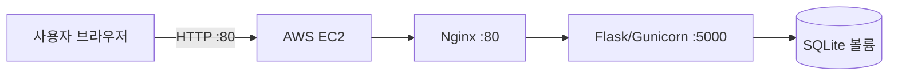

# 먼저가져가 - AWS 선착순 나눔 서비스

## 1. 서비스 소개

사용하지 않는 물건을 이웃에게 정해진 시간부터 선착순으로 나누는 웹서비스입니다. 지역 커뮤니티 구성원이 대상이며, 게시글과 메신저를 오가면서 신청 시작 시각과 신청 순서를 판단하기 어려운 문제를 해결합니다.

### 핵심 기능

1. **회원가입·로그인**: 아이디, 닉네임, 비밀번호와 비밀번호 확인을 입력해 가입하고 로그인 세션을 유지합니다.
2. **물건 등록·삭제**: 로그인한 사용자가 물건 정보와 신청 시작 시간을 초 단위로 등록하며, 본인이 만든 나눔만 삭제할 수 있습니다.
3. **검색과 분류**: 물건명 또는 동네로 검색하고 카테고리로 필터링합니다.
4. **예약 선착순 신청**: 등록된 시작 시각 전에는 카드에서 초 단위 실시간 카운트다운을 보여 주며 신청할 수 없습니다. 시각이 되면 `나눔 신청하기` 버튼이 활성화되고, 로그인한 사용자의 닉네임으로 즉시 신청됩니다. 동시 요청도 데이터베이스의 조건부 UPDATE로 한 건만 성공합니다.
5. **관리자 관리**: 환경변수로 생성된 관리자 계정은 모든 나눔 목록을 삭제할 수 있습니다.
6. **마이페이지**: 로그인 사용자는 자신이 등록한 나눔과 신청한 나눔을 구분해 보고, 진행 상태와 신청 시각을 확인할 수 있습니다.

## 2. AWS 구성과 요청 경로



- **EC2**: Docker Compose 앱을 실행하는 가상 서버입니다. 기존 컨테이너 구성을 그대로 배포할 수 있어 선택했습니다.
- **Nginx**: 외부 요청을 받고 Flask로 전달하는 리버스 프록시입니다.
- **Flask/Gunicorn**: 화면과 API 응답을 생성합니다.
- **SQLite 볼륨**: 단일 EC2 과제 환경에서 등록 및 신청 데이터를 보존합니다.
- 요청 경로: `브라우저 → EC2:80 → Nginx:80 → Flask:5000 → SQLite`

## 3. 로컬 실행

### 준비 사항

- Docker Desktop 및 Docker Compose
- 사용 포트: 호스트 `80`, Nginx `80`, Flask `5000`
- 운영 배포에서는 `.env` 파일에 충분히 긴 임의의 `SECRET_KEY`를 설정합니다.

관리자 계정을 사용할 때는 저장소에 비밀번호를 올리지 않고 `.env`에 다음 값을 설정합니다.

```env
SECRET_KEY=<충분히 긴 임의 문자열>
ADMIN_USERNAME=<관리자 아이디>
ADMIN_PASSWORD=<관리자 비밀번호>
ADMIN_DISPLAY_NAME=관리자
```

```bash
docker compose config
docker compose up -d --build
curl http://localhost/api/health
```

브라우저에서 `http://localhost`에 접속합니다.

### 자동 시험

```bash
python -m unittest -v test_app.py
```

## 4. AWS EC2 배포

1. Ubuntu EC2 인스턴스를 생성합니다.
2. 보안 그룹 인바운드에 SSH `22`(본인 IP)와 HTTP `80`(전체 IPv4)을 허용합니다.
3. Docker와 Git을 설치합니다.
4. Public GitHub 저장소를 내려받아 실행합니다.

```bash
git clone <PUBLIC_REPOSITORY_URL>
cd aws-first-share
docker compose config
docker compose up -d --build
curl http://localhost/api/health
```

배포 주소: `http://<EC2_PUBLIC_IP>`

## 5. 기능별 시험 결과

| 기능 | 구분 | 입력 | 기대 결과 | 실제 결과 |
|---|---|---|---|---|
| 회원가입 | 정상 | 새 아이디·닉네임·8자 이상 비밀번호 | 201, 가입 후 로그인 상태 | 로컬 자동 시험 통과 |
| 회원가입 | 실패 | 이미 존재하는 아이디 | 409, 중복 아이디 안내 | 로컬 자동 시험 통과 |
| 로그인 | 실패 | 잘못된 비밀번호 | 401, 로그인 실패 안내 | 로컬 자동 시험 통과 |
| 물건 등록 | 정상 | 이름 `무선 키보드`와 모든 필수값 | 201, 목록에 새 카드 표시 | 로컬 자동 시험 통과 |
| 물건 등록 | 실패 | 물건 이름 공란 | 400, 필수 입력 오류 | 로컬 자동 시험 통과 |
| 나눔 삭제 | 정상 | 작성자가 본인 나눔 삭제 | 200, 목록에서 제거 | 로컬 자동 시험 통과 |
| 나눔 삭제 | 실패 | 다른 사용자가 삭제 요청 | 403, 소유자 전용 안내 | 로컬 자동 시험 통과 |
| 관리자 삭제 | 정상 | 관리자가 다른 사용자의 나눔 삭제 | 200, 목록에서 제거 | 로컬 자동 시험 통과 |
| 검색·분류 | 정상 | 검색어 `키보드` | 일치하는 물건만 표시 | 로컬 자동 시험 통과 |
| 검색·분류 | 경계 | 검색어 `없는물건` | 빈 목록 안내 | 로컬 자동 시험 통과 |
| 예약 신청 | 경계 | 신청 시작 시각 전 신청 | 425, 시작 전 안내와 신청 차단 | 로컬 자동 시험 통과 |
| 선착순 신청 | 정상 | 로그인한 `민지`가 열린 물건 신청 | 200, 닉네임으로 나눔 완료 표시 | 로컬 자동 시험 통과 |
| 선착순 신청 | 실패 | 로그인하지 않고 신청 | 401, 로그인 필요 안내 | 로컬 자동 시험 통과 |
| 선착순 신청 | 실패 | 같은 물건에 두 번째 신청 | 409, 먼저 신청한 사용자 안내 | 로컬 자동 시험 통과 |

AWS 배포 뒤 실제 결과를 `AWS 배포 시험 통과`로 갱신하고 배포 주소 화면을 캡처합니다.

## 6. ELB와 Auto Scaling 확장 검토

현재 과제 규모에서는 단일 EC2로 충분해 ELB와 Auto Scaling을 실제 구축하지 않습니다. 로드 밸런서와 최소 인스턴스 유지 비용이 계속 발생하기 때문입니다.

행사 공지 직후처럼 접속이 급증하는 운영 환경에서는 ALB와 EC2 Auto Scaling을 적용할 수 있습니다. 다만 여러 인스턴스가 단일 SQLite 파일을 공유할 수 없으므로 데이터베이스를 Amazon RDS 또는 DynamoDB로 변경해야 합니다. ALB는 새 연결을 분산하고, Auto Scaling은 CPU 또는 요청 수 지표에 따라 인스턴스를 늘리고 줄입니다.

## 7. AI 활용 기록

- 도구: ChatGPT Work
- 활용 범위: 프로젝트 구조 초안, 코드 작성 지원, README 및 시험 항목 정리
- 직접 확인 사항: 로컬 자동 시험, Docker Compose 실행, AWS 배포 주소에서 기능 3개 정상·실패 시험
- 최종 제출 전 배포 환경의 실제 결과와 스크린샷은 작성자가 직접 확인합니다.

## 8. 검사 후 정리

검사가 끝날 때까지 EC2를 유지합니다. 검사 후 EC2 인스턴스와 연결 자원을 종료 또는 삭제할 수 있으며, Public GitHub 저장소와 제출 커밋은 보존합니다.
